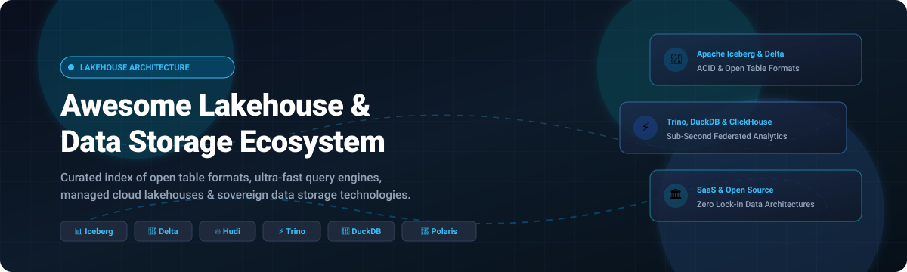

# 🌊 Awesome Lakehouse & Data Storage Ecosystem 🚀

**A curated, production-grade guide to modern Data Lakehouse platforms, Open Table Formats (OTFs), high-performance distributed query engines, and sovereign object storage architectures.**

*Tracking cutting-edge open table formats, ACID transactions on object storage, metadata catalogs, and next-generation lakehouse cloud platforms.*

[Market Dynamics](#-sector-overview--market-dynamics) • [SaaS Platforms](#-saashosted-platforms) • [Open-Source Ecosystem](#-open-source-github-projects) • [Architecture Guide](#-frameworks-for-building-custom-systems) • [Contributing](#-how-to-contribute)

---

## 📌 Table of Contents

- [🌐 Sector Overview & Market Dynamics](#-sector-overview--market-dynamics)
- [☁️ SaaS/Hosted Platforms](#-saashosted-platforms)
- [🐙 Open-Source GitHub Projects](#-open-source-github-projects)
  - [🏆 High-Impact Category Leaders](#-high-impact-category-leaders)
  - [🚀 Additional Specialized Lakehouse Tools](#-additional-specialized-lakehouse-tools)
- [🏗️ Frameworks for Building Custom Systems](#-frameworks-for-building-custom-systems)
- [🤝 How to Contribute](#-how-to-contribute)
- [⭐ Star History](#star-history)
- [☕ Support & Sponsorship](#-support--sponsorship)
- [⚖️ Disclaimer](#-disclaimer)

---

## 🌐 Sector Overview & Market Dynamics

The global **Data Lakehouse and Next-Generation Data Storage** market is estimated at **$18.5 Billion in 2025** and projected to surge past **$68.0 Billion by 2032**, demonstrating an exponential **CAGR of ~20.5%**. 

The sector is currently **moderately fragmented yet increasingly polarized around an oligopoly of format and compute titans** (Databricks, Snowflake, Google BigQuery, and AWS Redshift). While foundational open table formats like **Apache Iceberg**, **Delta Lake**, and **Apache Paimon** have commoditized open-standard storage layers, high-performance federated query engines and sovereign lakehouse platforms compete vigorously on cost-per-query efficiency, streaming ingestion speeds, and multi-cloud catalog interoperability.

---

## ☁️ SaaS/Hosted Platforms

The table below lists the industry's premier commercial and managed cloud lakehouse platforms, categorized by organizational scale, verifiable entry pricing models, and free evaluation limits:

| Platform / Vendor | Organization Size (Revenue / Valuation) | Pricing Model & Starting Rates | Free Tier / Trial Evaluation Limits | Key Lakehouse Focus & Capabilities |
| :--- | :--- | :--- | :--- | :--- |
| **[Google BigQuery](https://cloud.google.com/bigquery)** | **$350B+ Cloud/Parent Rev** (Alphabet: $2.1T+ Mkt Cap) | **$6.25 / TB** on-demand query analysis; Edition capacity begins at **$0.04 / slot-hour** (Standard) | **10 GB storage free/month + 1 TB queries free/month** forever; plus **$300 credit** (90-day trial) | Serverless multi-cloud data warehouse with BigLake support for Iceberg & Delta; BI Engine caching. |
| **[Amazon Redshift](https://aws.amazon.com/redshift/)** | **$107B+ AWS ARR** (Amazon: $1.9T+ Mkt Cap) | **$0.25 / hour** (dc2.large on-demand instance); Redshift Serverless at **$0.375 / RPU-hour** | **2-month free trial**: 750 dc2.large instance hours per month or **$300 Redshift Serverless credits** | AWS data warehouse with Spectrum for direct S3 lake queries, Redshift Managed Storage, and AQUA acceleration. |
| **[Databricks Lakehouse](https://www.databricks.com/)** | **$43.0 Billion Valuation** (~$2.6B+ ARR) | Compute from **$0.07 / DBU** (Standard Jobs); SQL Compute starts at **$0.22 / DBU** + underlying cloud VM costs | **14-day free trial** with full platform capabilities & Unity Catalog access (cloud infrastructure costs excluded) | Pioneer of Delta Lake; unified analytics with Photon engine, MLflow, and centralized Unity Catalog governance. |
| **[Snowflake](https://www.snowflake.com/)** | **$42.0 Billion Market Cap** (~$3.6B+ ARR) | **$2.00 / credit** (Standard Edition); Enterprise tier starts at **$3.00 / credit** + storage at **$23 / TB/month** | **30-day free trial with $400 in free usage credits** across multi-cloud environments | Separated compute/storage architecture, native Apache Iceberg table support, Snowpark, and Apache Polaris catalog. |
| **[Teradata Vantage](https://www.teradata.com/)** | **$3.1 Billion Market Cap** (~$1.8B ARR) | VantageCloud Lake starting at **~$1.68 / Vantage Unit (VU)** or dedicated compute instances from **~$3,500 / month** | **30-day free trial** with VantageCloud Lake preloaded sandbox environment and up to **$300 consumption credits** | Enterprise-grade hybrid cloud analytics platform with VantageCloud Lake offering native object store access. |
| **[Starburst Galaxy](https://www.starburst.io/)** | **$3.35 Billion Valuation** (~$120M ARR) | **$0.45 / Starburst Credit** (~$2.50 to $5.00 / active cluster hour) | **$500 in free usage credits** valid across an initial **30-day trial period** | Fully managed Trino service for cross-cloud federated lakehouse analytics with Warp Speed caching. |
| **[ClickHouse Cloud](https://clickhouse.com/)** | **$2.0 Billion Valuation** (~$80M+ ARR) | Development instances from **$0.16 / hour** (~$115/month); Production scale starting at **$0.54 / hour** | **30-day free trial with $300 in free cloud usage credits** without upfront commitment | Ultra-fast columnar OLAP database delivering sub-second queries on billions of rows over Iceberg and Delta. |
| **[SingleStore](https://www.singlestore.com/)** | **$1.3 Billion Valuation** (~$100M ARR) | Compute starting at **$0.80 / Compute-Hour** (S-00.5 instance, approx. **$584/month**) | **$600 free credit trial** (valid up to 14 days) or Starter tier evaluation with sandbox cluster access | Real-time distributed SQL database unifying transactional (OLTP) and analytical (OLAP) workloads on universal storage. |
| **[Dremio Cloud](https://www.dremio.com/)** | **$2.0 Billion Valuation** (~$60M ARR) | **$0.39 / Dremio Compute Unit (DCU)** per hour | **Free forever tier**: Unlimited query engine usage on self-managed infrastructure (users pay only their cloud provider S3/EC2 costs) | Open lakehouse platform powered by Apache Arrow, Iceberg REST catalog, and Reflections acceleration views. |
| **[Firebolt](https://www.firebolt.io/)** | **$1.4 Billion Valuation** (~$30M ARR) | Compute starting at **$0.063 / engine unit hour** (~$0.49 / hour for small clusters) | **30-day free trial with $200 in free query and storage credits** | Cloud data warehouse optimized for sub-second low-latency analytics on large-scale semi-structured datasets. |

---

## 🐙 Open-Source GitHub Projects

Explore the highest-starred and most actively maintained open-source projects powering the data lakehouse ecosystem. Each entry features a live GitHub star count badge linking directly to its repository stargazers page.

### 🏆 High-Impact Category Leaders

*Ranked strictly in descending order of GitHub community stars:*

- **[ClickHouse](https://github.com/ClickHouse/ClickHouse)**   
  ⚡ Fast, open-source columnar database management system for real-time analytical reporting. Seamlessly integrates with Apache Iceberg and Delta Lake for sub-second OLAP on object stores.

- **[Apache Spark](https://github.com/apache/spark)**   
  🔥 The foundational unified analytics engine for large-scale data processing, batch/streaming ETL, and the reference execution engine for Delta Lake, Iceberg, and Hudi.

- **[DuckDB](https://github.com/duckdb/duckdb)**   
  🦆 An in-process SQL OLAP database management system supporting direct querying of Iceberg, Delta, and Parquet data lakes locally and in the cloud with zero external dependencies.

- **[Apache Flink](https://github.com/apache/flink)**   
  🌊 High-throughput, stateful stream processing framework providing continuous streaming ingestion and CDC pipelines into modern lakehouses (Apache Paimon and Hudi).

- **[Apache Arrow](https://github.com/apache/arrow)**   
  🏹 Cross-language development platform for in-memory columnar analytics; the global standard data interchange format between lakehouse engines (DuckDB, Trino, DataFusion).

- **[Presto](https://github.com/prestodb/presto)**   
  🏛️ The classic distributed SQL query engine for big data and massive petabyte-scale data federation across open storage architectures.

- **[Apache Doris](https://github.com/apache/doris)**   
  🚀 Easy-to-use, high-performance real-time analytical database based on an MPP architecture with native integration for Iceberg and Hudi lakehouse catalogs.

- **[Apache Druid](https://github.com/apache/druid)**   
  📊 High-performance, real-time analytics database designed for fast streaming ingestion and sub-second operational analytics at petabyte scale.

- **[Trino](https://github.com/trinodb/trino)**   
  🌟 **The industry-standard distributed SQL query engine** for lakehouse analytics, delivering federated queries across Iceberg, Delta Lake, Hudi, Hive, and relational databases with zero data replication.

- **[StarRocks](https://github.com/StarRocks/starrocks)**   
  ⭐ Next-generation sub-second MPP analytical engine claiming up to 3x performance over conventional federated engines; directly queries Iceberg, Delta, and Hudi without pre-ingestion.

- **[Databend](https://github.com/datafuselabs/databend)**   
  🦀 **Open-source Snowflake alternative written in Rust** — unified analytics, vector search, full-text search, and geospatial workloads operating directly on cloud object storage.

- **[Apache DataFusion](https://github.com/apache/arrow-datafusion)**   
  ⚙️ Extensible, embeddable in-memory query engine written in Rust, leveraging Apache Arrow for ultra-fast custom query processing and custom lakehouse layers.

- **[Apache Iceberg](https://github.com/apache/iceberg)**   
  🧊 **The open-governance standard open table format** under the Apache Software Foundation. Features partition evolution, hidden partitioning, schema evolution, and universal engine support (Spark, Trino, Flink, Snowflake, BigQuery).

- **[Delta Lake](https://github.com/delta-io/delta)**   
  📐 High-performance storage layer providing ACID transactions, time travel, and scalable metadata handling under the Linux Foundation; integrates UniForm for Iceberg compatibility.

- **[Apache Hudi](https://github.com/apache/hudi)**   
  🔄 Streaming-first lakehouse table format featuring native CDC support, DeltaStreamer ingestion, and mature Merge-on-Read (MoR) for high-frequency database upserts and deletes.

- **[Apache Pinot](https://github.com/apache/pinot)**   
  🍷 Real-time distributed OLAP datastore designed for low-latency, high-concurrency user-facing applications over event streams and lakehouse stores.

- **[Apache Paimon](https://github.com/apache/paimon)**   
  ⏱️ Streaming lakehouse format purpose-built for Flink architectures, delivering changelog-native semantics, primary-key tables, and continuous data updates.

---

### 🚀 Additional Specialized Lakehouse Tools

- **[DuckLake](https://github.com/duckdb/ducklake)**  — DuckDB-native data lake and catalog format storing metadata inside relational databases, delivering up to 90% storage savings.
- **[Spice AI](https://github.com/spiceai/spiceai)**  — Standalone SQL query and AI inference engine with built-in CDC, vector search, and unified lakehouse acceleration.
- **[Apache Sedona](https://github.com/apache/sedona)**  — Distributed spatial analytics system extending Spark, Flink, and Snowflake to process geospatial big data on modern lakehouses.
- **[Apache Polaris](https://github.com/apache/polaris)**  — Open-source, vendor-neutral Iceberg REST Catalog implementation donated by Snowflake and Dremio under Apache governance for centralized multi-engine access control.
- **[Project Nessie](https://github.com/projectnessie/nessie)**  — Transactional Git-like catalog for Apache Iceberg enabling branching, tagging, and multi-table atomic transactions.
- **[Apache Iceberg Rust](https://github.com/apache/iceberg-rust)**  — Official native Rust implementation of the Apache Iceberg specification for memory-safe, ultra-fast table format manipulation.
- **[Apache XTable](https://github.com/apache/incubator-xtable)**  — Cross-format metadata translator providing seamless bidirectional interoperability between Apache Iceberg, Delta Lake, and Apache Hudi without duplicating data.
- **[kamu-cli](https://github.com/kamu-data/kamu-cli)**  — Decentralized lakehouse and stream processing network featuring cryptographic provenance and peer-to-peer data pipeline sharing.
- **[Pivot](https://github.com/pivotlake/pivot)**  — High-performance Rust-based analytics engine querying open table formats directly on object storage with morsel-driven parallelism.
- **[CowsDB](https://github.com/cowsdb/cowsdb)**  — Stateless serverless OLAP engine compatible with the ClickHouse HTTP API, optimized for CI pipelines and microservices.

---

## 🏗️ Frameworks for Building Custom Systems

To design a scalable, vendor-neutral lakehouse architecture:

1. **Table Format**: Choose **[Apache Iceberg](https://github.com/apache/iceberg)** for multi-engine portability, **[Delta Lake](https://github.com/delta-io/delta)** for Databricks-centered ecosystems, or **[Apache Paimon](https://github.com/apache/paimon)** for high-throughput streaming CDC with Apache Flink.
2. **Catalog & Governance**: Deploy **[Apache Polaris](https://github.com/apache/polaris)** (Iceberg REST catalog standard) or **[Project Nessie](https://github.com/projectnessie/nessie)** for Git-like branching, tagging, and atomic catalog changes.
3. **Query Engine**: Use **[Trino](https://github.com/trinodb/trino)** or **[StarRocks](https://github.com/StarRocks/starrocks)** for federated interactive SQL, **[Apache Spark](https://github.com/apache/spark)** for large-scale batch ETL, and **[DuckDB](https://github.com/duckdb/duckdb)** for fast embedded in-process queries.
4. **Storage Layer**: Pair with Amazon S3, Google Cloud Storage, Azure Data Lake Storage Gen2, or self-hosted S3-compatible **MinIO** clusters.

---

## 🤝 How to Contribute

We welcome contributions from data engineers, architects, and open-source creators!

1. 🍴 Fork the repository.
2. 📝 Add or refine entries in `README.md` following the existing format.
3. 🔎 Provide factual descriptions, official documentation URLs, and GitHub stargazers links.
4. 🚀 Submit a Pull Request with a clear description of your additions.

⭐ **Star the repo** if you find it valuable for your data engineering journey!

---

##  Star History

---

## ☕ Support & Sponsorship

If you find this curated Lakehouse ecosystem directory useful for your team, research, or architecture planning, please consider showing your support:

- ⭐ **Star this repository** to help others discover it on GitHub.
- 🍴 **Fork and contribute** new open table formats, query engines, or benchmarks.
- 📢 **Share it** with colleagues, data engineering communities, and on social channels.
- ☕ **Buy me a coffee / Sponsor**: If you'd like to back ongoing maintenance and updates, visit the [GitHub Sponsors Dashboard](https://github.com/sponsors/ishandutta2007). Thank you for keeping open data architectures thriving!

---

## ⚖️ Disclaimer

- This is a community-curated, educational index — inclusion does not imply official endorsement.
- All brand names, logos, and trademarks belong to their respective corporate owners.
- When architecting production lakehouses, evaluate compliance requirements (GDPR, HIPAA, SOC 2) and benchmark engine performance against your specific workloads.

---

**Built with ❤️ for data engineers, platform architects, and open-source advocates.**

[Back to Top ⬆️](#-awesome-lakehouse--data-storage-ecosystem-)

